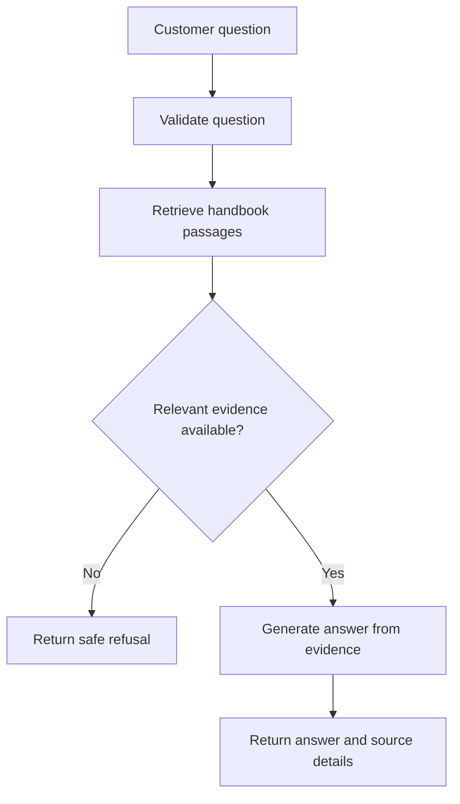
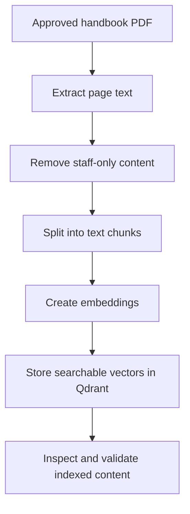

# Clause — AI-Powered Shop Assistant

**Clause** is a Retrieval-Augmented Generation (RAG) project that explores how an AI assistant can answer customer-support questions from an approved shop handbook instead of relying on unsupported general knowledge.

The project focuses on three connected goals:

1. **Grounded answers** — retrieve relevant handbook passages and use them as the evidence for customer-facing answers.
2. **Reliable abstention** — say when the available handbook evidence does not support an answer.
3. **Information protection** — keep internal, staff-only material out of the customer-facing knowledge index before it is embedded.

> **Project stage:** This repository is being assembled as a reproducible project and experiment record. The documentation and evaluation datasets are published, but the complete runnable backend, final evaluation outputs, and workbook must be checked in before this repository can be described as a fully reproducible release. Historical results below are clearly labelled and are not represented as fresh runs.

---

## Contents

- [Why Clause?](#why-clause)
- [How it works](#how-it-works)
- [Architecture](#architecture)
- [Technology](#technology)
- [Repository structure](#repository-structure)
- [Evaluation design](#evaluation-design)
- [V1–V7 experiment plan](#v1v7-experiment-plan)
- [Historical results currently available](#historical-results-currently-available)
- [Security and privacy](#security-and-privacy)
- [Reproducibility](#reproducibility)
- [Current limitations and next steps](#current-limitations-and-next-steps)
- [Project documentation](#project-documentation)
- [License](#license)

## Why Clause?

A general-purpose language model may produce a confident answer even when a shop's policy does not support it. In customer support, that can lead to incorrect promises about refunds, delivery, warranties, payments, or account information.

Clause uses a shop handbook as its knowledge source. It is designed to retrieve relevant policy text, answer only when adequate evidence is available, and abstain when the evidence is missing or insufficient.

The project also treats data handling as part of the system design: internal operational instructions must be filtered out before the customer-facing retrieval index is created. A prompt telling the model not to reveal information is not a substitute for excluding that information from the index.

## How it works

The intended question-answering flow is:



The knowledge-preparation flow is:



**Important security boundary:** filtering internal content must happen before chunking and embedding. Refusal tests are useful, but they do not prove that sensitive text is absent from the vector store.

## Architecture

The project architecture is organized around these responsibilities:

| Layer | Responsibility |
|---|---|
| Configuration | Loads model, embedding, chunking, retrieval, and vector-store settings from environment variables. |
| Ingestion | Extracts handbook text, excludes unauthorized content, creates chunks and embeddings, and indexes approved content. |
| Vector store | Stores the indexed handbook content for semantic and/or hybrid retrieval. |
| Retrieval | Finds relevant handbook passages for a customer question and applies the configured relevance rules. |
| Answer generation | Uses the question and retrieved evidence to generate a concise, grounded response or abstention. |
| API / CLI | Provides interfaces for asking questions and operating the application. |
| Evaluation | Runs labelled questions and records retrieval, answer, refusal, and restricted-information outcomes. |

The project history includes an earlier dense-retrieval design and a later hybrid dense/sparse retrieval implementation. The precise behaviour of an experiment must be read together with the code revision and configuration used for that run; settings from one version must not be assumed to apply to every version.

See [docs/architecture.md](docs/architecture.md) for the component-level design and operational notes.

## Technology

The project configuration and architecture records identify the following technologies:

| Technology | Role |
|---|---|
| Python 3.13 | Backend language |
| [uv](https://docs.astral.sh/uv/) | Python environment and dependency management |
| [FastAPI](https://fastapi.tiangolo.com/) | Backend API framework |
| [LangChain](https://www.langchain.com/) | Model, embedding, and retrieval integrations |
| [Qdrant](https://qdrant.tech/) | Vector database |
| Ollama | Local model / embedding provider option |
| Google GenAI | Hosted chat-model provider option in the shared configuration |
| JSONL | Golden evaluation datasets |

Model names, providers, vector dimensions, and retrieval parameters are configuration-dependent. Refer to the checked-in environment template and the matching experiment record rather than assuming one model configuration is universal.

## Repository structure

The repository is being organized as follows. The tree distinguishes the intended project layout from files that must still be added or verified.

```text
clause/
├── README.md
├── .gitignore
├── api/
│   ├── app/
│   │   ├── core/
│   │   │   └── config.py
│   │   ├── schemas/
│   │   ├── services/
│   │   ├── cli.py
│   │   └── main.py
│   ├── evals/
│   │   ├── golden.jsonl
│   │   ├── golden_v2.jsonl
│   │   ├── run.py
│   │   └── results/
│   │       ├── results.txt
│   │       └── evaluation_results.xlsx
│   ├── .env.example
│   ├── pyproject.toml
│   └── uv.lock
├── docs/
│   ├── architecture.md
│   └── experiments.md
└── web/
```

The evaluation result files and some application files shown in this target structure are planned deliverables; their presence should be verified in the repository before treating the tree as a complete inventory.

## Evaluation design

Clause uses labelled JSON Lines (JSONL) datasets. Each line represents one test case.

| Dataset | Total cases | Answerable | Out of scope | Restricted |
|---|---:|---:|---:|---:|
| `golden.jsonl` | 22 | 16 | 4 | 2 |
| `golden_v2.jsonl` | 49 | 35 | 9 | 5 |

### Case categories

- **answerable** — the handbook contains the information needed to answer the question.
- **out_of_scope** — the handbook does not provide the requested information; the assistant should abstain.
- **restricted** — the question tests whether staff-only or otherwise prohibited information is exposed.

### Metrics

Report both the raw count and the denominator alongside every percentage.

| Metric | What it measures |
|---|---|
| Retrieval / page hit rate | Answerable cases where a retrieved source matches an expected handbook page. |
| Evidence present in retrieved chunks | Answerable cases where the required supporting fact is present in the retrieved text. |
| Answer correctness | Answerable cases whose response satisfies the expected answer criteria. |
| Out-of-scope refusal rate | Out-of-scope cases correctly refused. |
| Restricted-information leak rate | Restricted cases whose response contains prohibited information. |

These metrics measure different stages. For example, retrieving the correct page does not guarantee that the model will formulate the correct answer. Likewise, a refusal test does not establish that sensitive content was removed from the underlying index.

**Dataset comparison caution:** `golden.jsonl` and `golden_v2.jsonl` have different sizes and category distributions. Their overall pass percentages are not directly comparable without explaining the dataset and denominator differences.

## V1–V7 experiment plan

The experiment series studies the effect of prompting, generation settings, model selection, retrieval depth, ingestion-time filtering, and hybrid retrieval.

| Version | Change under study | Dataset |
|---|---|---|
| V1 | Original baseline | `golden.jsonl` |
| V2 | Simple system prompt and prompt template | `golden.jsonl` |
| V3 | Temperature set to 0 | `golden.jsonl` |
| V4 | Chat-model comparison | `golden.jsonl` |
| V5 | Top-k set to 2 | `golden.jsonl` |
| V6 | Remove staff-only section during ingestion | `golden.jsonl` |
| V7 | Final hybrid RAG implementation | `golden_v2.jsonl` |

For V3–V6, the intended methodology is to change the named factor while keeping other settings stable where possible. Any additional changes must be recorded so that the effect of an experiment is not misattributed.

See [docs/experiments.md](docs/experiments.md) for the detailed plan, metric definitions, historical observations, and reproduction checklist.

## Historical results currently available

The following values were shared as historical experiment results during development. They are included for transparency; they are **not newly executed results from the current GitHub repository**.

### V1 — Original baseline

Dataset: `golden.jsonl` (22 cases).

| Metric | Historical result |
|---|---:|
| Retrieval / page hit rate | 100% |
| Evidence present in chunks | 100% |
| Answer correctness | 44% |
| Out-of-scope refusal rate | 75% |
| Restricted-information leak rate | 100% |

**Observation:** the historical run retrieved the expected page and supporting facts, but answer generation was frequently incorrect. Both restricted test cases exposed internal-only information.

### V2 — Prompt and template change

Dataset: `golden.jsonl` (22 cases).

| Metric | Historical result |
|---|---:|
| Retrieval / page hit rate | 100% |
| Evidence present in chunks | 100% |
| Answer correctness | 25% |
| Out-of-scope refusal rate | 100% |
| Restricted-information leak rate | 0% |

**Observation:** the stricter prompt improved the observed refusal and leakage results, but answer correctness decreased compared with V1. This illustrates why safety and answer quality must be measured separately.

### Earlier V7 architecture snapshot — not the final V7 evaluation

A previously shared architecture report records **9/22 passed** on the 22-case dataset:

| Metric | Earlier reported result |
|---|---:|
| Retrieval hit rate | 100% |
| Evidence present in chunks | 100% |
| Answer correctness | 18.8% (3/16) |
| Out-of-scope refusal rate | 100% (4/4) |
| Restricted-information leak rate | 0% (0/2) |

This is an earlier architecture snapshot using the 22-case dataset. It is **not** the final V7 result, because the final experiment plan assigns V7 to the expanded 49-case `golden_v2.jsonl` dataset. The earlier report also recorded implementation/evaluation caveats, including a diagnostic retrieval path that did not apply the same threshold as the live path.

V3–V6 and the final 49-case V7 run should only be reported after their matching code/configuration and complete outputs have been verified.

## Security and privacy

The handbook used during development contains customer-facing content and a staff-only section. Protecting that material is a core system requirement.

- Exclude staff-only content **before chunking, embedding, and indexing**.
- Treat prompt instructions as behaviour guidance, not as an authorization boundary.
- Inspect extracted text and indexed chunks to confirm that restricted material is absent.
- Do not publish the original handbook if it contains internal or confidential information.
- Never commit `.env`, API keys, access tokens, or other secrets.
- Keep local Qdrant storage, vector databases, virtual environments, and caches out of version control.
- Rebuild and validate the index after changing ingestion or filtering logic.
- Use a safe collection-rebuild process: build and validate a replacement before switching away from a working collection.

## Reproducibility

For every experiment, record:

1. Git commit or source revision.
2. Dataset filename and category counts.
3. Chat provider, model, and temperature.
4. Embedding provider, model, and vector dimension.
5. Retrieval mode, top-k, and relevance threshold.
6. Chunk size and overlap.
7. Whether the indexed handbook was sanitized and validated.
8. Per-question outcomes and aggregate counts.
9. Complete terminal output and the generated machine-readable report.
10. Date/time and any deviations from the planned single-variable change.

Local/embedded Qdrant storage may not support simultaneous access from multiple processes. Run ingestion, the API, CLI, and evaluation sequentially against the same local storage directory unless a Qdrant server is configured.

## Current limitations and next steps

This is an evolving research prototype. The following work is required before calling the repository a fully reproducible release:

- Publish and review the complete backend source tree.
- Verify the exact API routes, request/response schemas, and startup commands against the implementation.
- Verify the ingestion filter and inspect the final indexed content for staff-only material.
- Reproduce V3–V6 and final V7 with recorded configurations.
- Commit the complete V1–V7 terminal log and an evaluation workbook with case-level data, metrics, and observations.
- Confirm that the README's setup instructions work from a clean clone.

The project should not claim that an experiment passed, that the API is runnable, or that sensitive data is excluded unless the corresponding implementation and evidence are available.

## Project documentation

- [Architecture](docs/architecture.md) — components, ingestion, retrieval, evaluation, and operational considerations.
- [Experiment plan and historical results](docs/experiments.md) — V1–V7 plan, datasets, metric definitions, historical observations, and reproduction checklist.
- [Evaluation dataset guide](api/evals/README.md) — JSONL structure, case types, and evaluation conventions.

## License

No license has been selected for this repository yet. Until a license is added, the project remains under the default copyright protections; reuse and redistribution are not granted by an open-source license.
